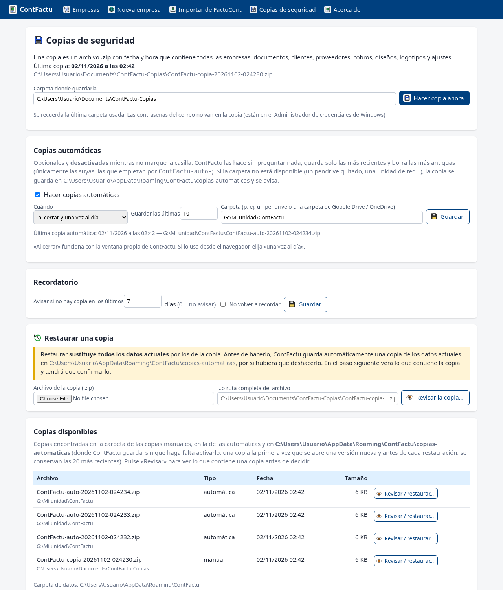
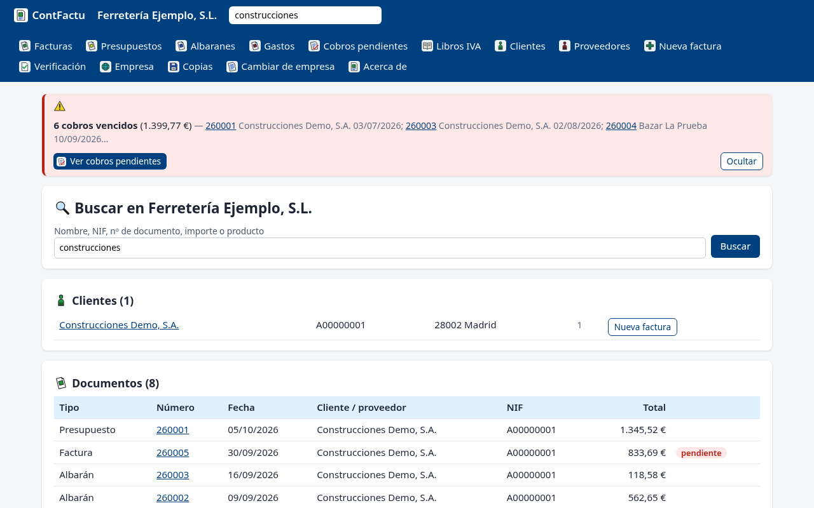
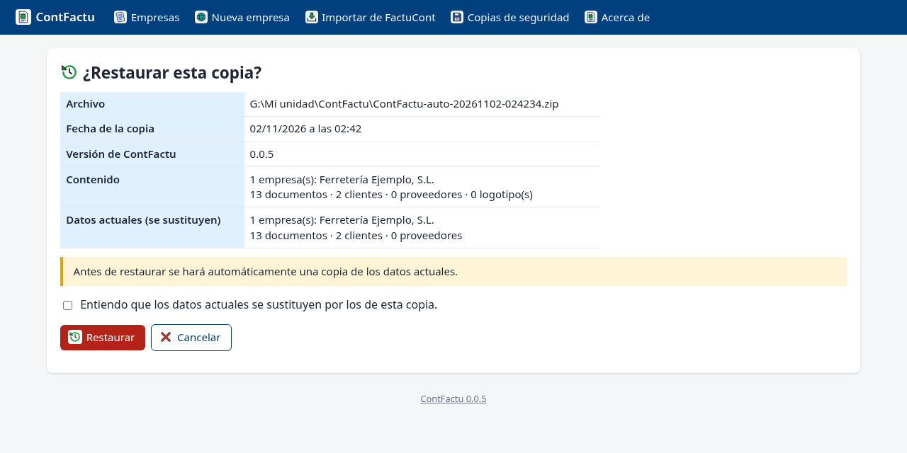
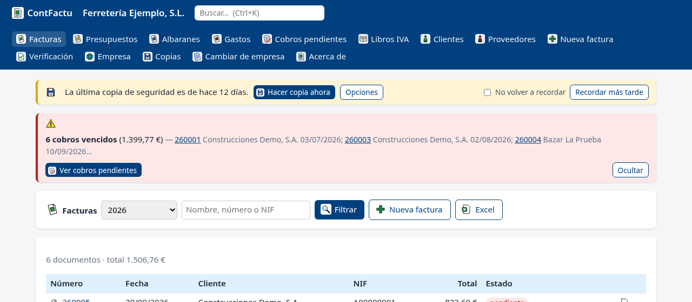

# ContFactu

Programa de facturación libre para Windows 10/11, pensado para pequeñas empresas y autónomos de España.
Desde el código fuente también puede ejecutarse en Linux, aunque eso no se prueba con regularidad.
Sirve como sustituto de **FactuCont 5**: puede **leer sus datos para importarlos** o empezar desde cero con una empresa nueva.

> ContFactu es un proyecto independiente. **No está afiliado a Binarema ni respaldado por ella.** «FactuCont» se nombra
> solo para indicar con qué formato de datos es compatible. Lee los archivos de FactuCont 5 (dBase y diseños `.fmt`)
> únicamente para que puedan pasarse a ContFactu. No incluye código, imágenes, iconos ni diseños de Binarema.

Interfaz en español, en su propia ventana (Edge WebView2) o en el navegador. Los datos se guardan solo en el ordenador,
en `%APPDATA%\ContFactu` (base de datos SQLite). No se envía nada a Internet, salvo las facturas que usted mande por correo
con su propio servidor de correo, y solo cuando pulsa «Enviar».

Estado: **0.2.0**. Sigue en evolución (vea las limitaciones). Haga copias de seguridad.


**Contenido:** [Funciones](#funciones) · [Requisitos](#requisitos) · [Instalar y actualizar](#instalar-y-actualizar) ·
[Importar de FactuCont 5](#importar-de-factucont-5) · [Datos y copias de seguridad](#datos-y-copias-de-seguridad) ·
[Correo](#enviar-facturas-por-correo) · [App Android (beta)](#app-android-beta) ·
[Desarrollo](#ejecutar-desde-el-código-desarrollo) · [Pruebas](#pruebas) · [Construir el instalador](#construir-el-instalador-windows) ·
[Limitaciones y planes](#limitaciones-y-planes) · [Apoyar el proyecto](#apoyar-el-proyecto) · [Licencia](#licencia)

## Funciones

- **Primera pantalla** con dos opciones: empezar desde cero o importar de FactuCont.
- **Empresa nueva** con datos fiscales (con comprobación del NIF/CIF), serie y primer número de factura, tipos de IVA y logotipo.
  Se pueden tener **varias empresas**.
- **Importación de FactuCont 5** desde una carpeta `FC5`, un `.zip` o un `.rar`:
  - qué se importa: empresas, clientes, proveedores, facturas, albaranes, presupuestos, gastos, líneas y vencimientos;
  - conserva la numeración y se puede repetir;
  - verifica los totales línea a línea.
- **Facturas, presupuestos, albaranes y gastos**:
  - numeración correlativa `[serie][AA][número]` (p. ej. `260001`);
  - modificar y borrar, con aviso si se rompe la numeración;
  - **rectificativas** (serie R), por diferencias o por sustitución;
  - pasar presupuestos y albaranes a factura, juntando varios albaranes.
- **Cobros** totales o parciales, cobros pendientes y **recibos**.
- **Fichas de clientes y proveedores**.
- **PDF**:
  - con un diseño propio por defecto;
  - con el diseño `.fmt` de cada empresa importada, para que las facturas salgan como antes.
- **IVA sin límites**: cualquier tipo entre 0 % y 100 % (ambos incluidos), con los decimales que hagan falta (p. ej. 7,5 o 7,555), en cada línea, y tantos tipos
  distintos por factura como haga falta. Cada empresa tiene su lista editable de tipos habituales y de recargo de equivalencia.
- **Libros de IVA** de emitidas y recibidas, con recargo de equivalencia y retenciones. Exportan a CSV y a Excel con columnas
  al estilo de los libros registro de la AEAT, e incluyen un resumen **orientativo** del modelo 303.
- **Exportar a Excel** los listados de facturas (y demás documentos), clientes, proveedores y cobros pendientes, con
  formatos de fecha e importe y fila de totales.
- **Enviar facturas por correo** con el PDF adjunto, desde el servidor de correo de cada empresa. Siempre con vista previa
  y solo al pulsar «Enviar»; queda registro de cada envío en el documento.
- **Avisos al abrir**: cobros vencidos y que vencen en los próximos 7 días, y recordatorio de copia de seguridad.
- **Copias de seguridad en un clic** y restauración, con copia automática antes de cada actualización.
- **Copias automáticas opcionales** (desactivadas hasta que se activan): al cerrar ContFactu y/o una vez al día, en la
  carpeta que se elija (un pendrive, Google Drive, OneDrive…), guardando solo las últimas (10 por defecto).
- **Restaurar desde la lista de copias**, con vista previa del contenido (empresas, documentos, fecha y versión).
- **Buscador**: una casilla en la barra superior (o `Ctrl+K`) que encuentra clientes, proveedores, documentos (por número,
  nombre, NIF, importe o concepto) y productos de la empresa abierta.
- **Acceso desde el móvil** (opcional, desactivado hasta que se active en Ajustes): un móvil Android emparejado
  puede consultar facturas y clientes, crear y editar facturas y ver el PDF. Los datos siguen en el PC.
  Sirve en la wifi y, con datos móviles, a través de WireGuard o Tailscale, sin abrir puertos del router.
  Guía: [docs/acceso-movil.md](docs/acceso-movil.md). La app Android, en **beta**, se describe en
  [App Android (beta)](#app-android-beta).

Capturas (con datos inventados) en [`capturas/`](capturas/). Algunas de la 0.0.5:

| Copias automáticas (opcionales) | Buscador |
| --- | --- |
|  |  |
|  |  |

## Requisitos

- Windows 10 o Windows 11 de **64 bits**.
- **Microsoft Edge WebView2 Runtime**, que viene con Windows 11 y con Windows 10 actualizado. Si falta, ContFactu se abre en el navegador.
  También se puede instalar desde [Microsoft](https://developer.microsoft.com/microsoft-edge/webview2/).
- Permiso de administrador para instalar. Para usar el programa no hace falta.

## Instalar y actualizar

1. Descargue `ContFactu-Setup-<versión>.exe` de la [última versión publicada](https://github.com/LomoXSoft/ContFactu/releases/latest).
   Si quiere, compruebe su SHA-256, que figura en las notas de la versión:
   `Get-FileHash .\ContFactu-Setup-0.2.0.exe` en PowerShell.
2. Ejecútelo. Se instala en `C:\Program Files\ContFactu` y crea accesos directos en el menú Inicio y, si lo elige, en el escritorio.
   El instalador no está firmado digitalmente, así que Windows SmartScreen puede avisar: «Más información» → «Ejecutar de todas formas».
3. **Actualizar**: ejecute el instalador de la versión nueva encima de la anterior, **en la misma carpeta** (la que
   propone). No hace falta desinstalar antes.
   - Si ContFactu está abierto, pide cerrarlo.
   - Los datos se conservan. La primera vez que se abre una versión nueva, ContFactu hace **antes** una copia de seguridad
     automática y después pone al día la base de datos (ver [Comprobar una actualización](#comprobar-una-actualización)).
   - Las versiones de prueba 0.0.1 y 0.0.2, que se instalaban en la carpeta del usuario, se desinstalan solas.
4. **Desinstalar**: desde *Configuración → Aplicaciones*. Los datos de `%APPDATA%\ContFactu` se conservan.

### Comprobar una actualización

La **0.2.0** añade el acceso desde el móvil, desactivado hasta que se encienda en Ajustes. Quien actualiza
desde la 0.1.0 no nota ningún cambio de uso: la ventana sigue escuchando solo en este equipo. La primera
apertura hace la copia `ContFactu-antes-de-0.2.0-<fecha>.zip` y deja los datos donde estaban. En «Acerca de»
debe figurar **0.2.0**.

La **0.1.0** corrige un bloqueo al abrir en Windows: con la 0.0.5 la ventana podía quedarse «No responde» justo al
arrancar, con la pantalla de carga todavía delante, y había que forzar el cierre. No cambia el uso del programa.

Para quedarse tranquilo al actualizar un equipo que ya tiene datos (por ejemplo, de la 0.0.1, la 0.0.4 o la 0.0.5):

1. **Antes**, con la versión antigua abierta, anote algunos datos de control: el número de empresas, y de una de ellas el
   número de facturas del año y el total de la última factura. (Si quiere, copie además la carpeta `%APPDATA%\ContFactu`
   a un pendrive.)
2. Cierre ContFactu y ejecute el instalador nuevo.
3. Abra ContFactu. La ventana debe responder y la pantalla de carga desaparecer. En «Acerca de» debe figurar la versión nueva (ahora, **0.2.0**).
4. Abra la carpeta `%APPDATA%\ContFactu\copias-automaticas` (pegue la ruta en la barra del Explorador): debe haber un
   archivo `ContFactu-antes-de-<versión>-<fecha>.zip` (por ejemplo, `ContFactu-antes-de-0.2.0-<fecha>.zip`). Es la copia de los datos tal como estaban **antes** de actualizar.
   En la pantalla «Copias de seguridad» aparece en la lista «Copias disponibles».
5. Compruebe los datos de control del paso 1: mismas empresas, mismas facturas y mismos totales.
6. Si algo no cuadra, en «Copias de seguridad» pulse «Revisar / restaurar…» junto a esa copia automática. También puede
   volver a instalar la versión anterior y restaurar esa copia.

## Importar de FactuCont 5

1. En el equipo donde están los datos al día de FactuCont 5, cierre FactuCont y copie la carpeta `FC5`.
   Normalmente está en `C:\Binarema\FC5` y tiene subcarpetas `00001`, `00002`… (una por empresa).
   También vale comprimida en un `.zip` o un `.rar`.
2. En ContFactu, elija «Importar de FactuCont». Aparece en la primera pantalla y también en *Cambiar de empresa → Importar de FactuCont*.
   Después indique la carpeta o el archivo.
3. Pulse «Importar». Se importan todas las empresas con datos de la carpeta `FC5`.
   Si una tiene el mismo código que una empresa creada en ContFactu, se omite y se avisa.
   - FactuCont **no se modifica**: solo se leen sus archivos.
   - La importación se puede repetir: vuelve a cargar lo importado y respeta los documentos creados en ContFactu.
   - En la pantalla *Verificación* se comparan los totales de cada documento con sus líneas.

## Datos y copias de seguridad

- Todo se guarda en `%APPDATA%\ContFactu`: la base de datos `contfactu.db`, los logotipos y el registro `contfactu.log`.
  ContFactu nunca escribe en la carpeta del programa ni envía datos por Internet.
- **Copia de seguridad en un clic**: menú «Copias» → «Hacer copia ahora». Crea un `.zip` con fecha y hora
  (`ContFactu-copia-AAAA-MM-DD_HHMMSS.zip`) con la base de datos, los logotipos y los ajustes. La copia de la base se hace
  con la función de copia de SQLite, así que es coherente aunque ContFactu esté abierto.
  - Por defecto se guarda en `Documentos\ContFactu-Copias`. Puede elegir otra carpeta (un pendrive, OneDrive…) y ContFactu
    la recuerda.
  - Si pasan más de 7 días sin copia, ContFactu lo recuerda al abrir. Los días se cambian en la misma pantalla (0 = no avisar).
    El aviso tiene una casilla **«No volver a recordar»**; para volver a activarlo, desmárquela en «Copias» → «Recordatorio».
- **Copias automáticas (opcionales)**: en «Copias» → «Copias automáticas», marque «Hacer copias automáticas».
  - **Por defecto están desactivadas**: quien actualiza desde la 0.0.4 no nota ningún cambio hasta que las activa, y
    ContFactu no pregunta nada al abrir ni al cerrar.
  - Cuándo: al cerrar ContFactu (por defecto), una vez al día al abrirlo, o ambas. «Al cerrar» funciona con la ventana
    propia; si usa el navegador, elija «una vez al día».
  - Dónde: por defecto, la misma carpeta de las copias manuales (`Documentos\ContFactu-Copias`); puede elegir un pendrive
    o una carpeta sincronizada (Google Drive, OneDrive…).
  - Se guardan las últimas 10 (configurable de 1 a 200). Solo se borran las antiguas creadas así (`ContFactu-auto-….zip`),
    nunca las manuales.
  - Si la carpeta no está disponible (pendrive quitado, unidad desconectada), la copia se guarda en
    `%APPDATA%\ContFactu\copias-automaticas` y se avisa la próxima vez que se abre el programa.
  - Las copias automáticas cuentan para el recordatorio de los 7 días.
- **Restaurar**: en «Copias de seguridad», en la lista «Copias disponibles», pulse «Revisar / restaurar…», o elija el `.zip`. ContFactu muestra lo que contiene (empresas, documentos, clientes,
  proveedores, fecha y versión) junto a los datos actuales, y pide confirmación. Antes de sustituir nada, guarda una copia
  automática de los datos actuales para poder deshacerlo. Las copias de versiones anteriores se ponen al día al restaurarlas.
- **Buscador**: la casilla «Buscar…» de la barra superior (o `Ctrl+K`). Busca en la empresa abierta clientes y proveedores
  (nombre, NIF, código, población), documentos (número, cliente o proveedor, NIF, importe total como `121,00`, nº de factura
  del proveedor o concepto de una línea) y productos (conceptos de las líneas, con su último precio). Con ↓ ↑ se recorren
  los resultados y con Intro se abre el elegido. Nunca se abre sola.
- **Copias automáticas** en `%APPDATA%\ContFactu\copias-automaticas`: antes de poner al día la base de datos con una versión
  nueva y antes de cada restauración. Se conservan las 20 más recientes.
- Las contraseñas del correo **no** están en la base de datos ni en las copias: se guardan en el Administrador de credenciales
  de Windows (entrada `ContFactu-SMTP`). Tras restaurar en otro equipo, vuelva a escribirla en «Correo».

## Enviar facturas por correo

1. En «Empresa» → «Configurar el correo», indique el servidor de salida (SMTP), el puerto, la seguridad (SSL o STARTTLS),
   el usuario y la contraseña. Pulse «Probar conexión»: comprueba el acceso sin enviar nada. Algunos proveedores (Gmail,
   Outlook.com) exigen una «contraseña de aplicación».
2. Ajuste si quiere el asunto y el texto. Admiten marcadores como `{numero}`, `{fecha}`, `{total}`, `{cliente}` o `{empresa}`.
3. En una factura pulse «Enviar por correo…». Se rellena el correo del cliente de su ficha. Revise la vista previa, cambie
   lo que quiera y pulse «Enviar». Nada se envía sin ese clic. El envío (o el error) queda anotado en la factura.

## App Android (beta)

La app **ContFactu para Android** es, de momento, una **versión beta**: cubre lo básico para consultar facturas
y crear unas rápidas desde el móvil, y puede tener fallos o cambiar. Comparte la numeración con el programa del PC
(la 0.2.0 del móvil va con la 0.2.0 del PC). Su código está en [`android/`](android/), también bajo GPL v3.

**Qué hace**
- Consulta las facturas por año, con búsqueda, y su detalle y PDF.
- Crea y edita facturas. El número y los totales los calcula el PC; el IVA de cada línea es libre (entre 0 % y 100 %).
- Consulta y busca clientes.
- Si un dato no vale (NIF, IVA, descuento…), el aviso sale en ese campo y se conserva lo escrito.

**Los datos se quedan en el PC.** La app no guarda facturas, clientes ni copias. En el móvil solo quedan el token
del dispositivo y la huella del certificado del PC, cifrados con el almacén de claves de Android. El PDF se abre desde
la caché temporal y se borra al salir. Sin servicios de Google, sin analítica y sin publicidad.

**Instalar**
1. Descargue `ContFactu-<versión>-android-beta.apk` de la [última versión publicada](https://github.com/LomoXSoft/ContFactu/releases/latest)
   y compruebe su SHA-256 y la huella del certificado de firma, que figuran en las notas de la versión.
2. Ábralo en el móvil (Android 8.0 o superior) y permita instalar apps de ese origen cuando lo pida.
3. Para actualizar, instale la APK nueva encima de la anterior: está firmada con la misma clave.

**Emparejar**
1. En el PC: *Ajustes → «Permitir acceso desde el móvil»* (viene desactivado). Windows puede preguntar por el
   cortafuegos: permita solo las **redes privadas**.
2. En el móvil: escanee el QR que aparece en Ajustes. Sin cámara, «a mano» basta con la dirección IP del PC y el código
   `XXXX-XXXX`; la huella del certificado se comprueba sola antes de enviar nada.
3. El código vale 10 minutos y una sola vez. En el PC se ve la lista de dispositivos y se puede revocar cualquiera.

**Con datos móviles** (fuera de la wifi de casa o de la oficina): use una VPN privada entre el móvil y el PC
(WireGuard o Tailscale). No hace falta abrir puertos del router. Guía: [docs/acceso-movil.md](docs/acceso-movil.md).

**Firma de la APK.** Las APK publicadas se firman con la clave de publicación de LomoXSoft, que se guarda fuera del
repositorio. Ni la clave ni su contraseña están en GitHub. Gradle lee la firma de un archivo de propiedades fuera de
git (variable `CONTFACTU_FIRMA`), y quien compile su propia copia sin ese archivo obtiene una APK sin firmar. Detalles en
[`android/README.md`](android/README.md).

## Ejecutar desde el código (desarrollo)

Requisitos: Python 3.12 o superior.

```bash
python -m venv .venv
.venv\Scripts\activate            # Linux/macOS: source .venv/bin/activate
pip install -r requirements.txt
python -m app                     # abre la ventana (o http://127.0.0.1:8765)
```

Variables de entorno útiles:

| Variable | Para qué sirve |
| --- | --- |
| `CONTFACTU_DATA` | Carpeta de datos. |
| `CONTFACTU_DB` | Ruta de la base de datos. |
| `CONTFACTU_PORT` | Puerto de la ventana (solo en este equipo). |
| `CONTFACTU_MOVIL_PUERTO` | Puerto del acceso móvil, si está activado. Por defecto, 8766. |
| `CONTFACTU_NAVEGADOR=1` | Abre en el navegador en vez de la ventana propia. |
| `CONTFACTU_NO_BROWSER=1` | Arranca solo el servidor. |

Datos de demostración (empresa ficticia «Ferretería Ejemplo, S.L.»): `python -m herramientas.demo datos_demo/demo.db`
y después `CONTFACTU_DB=datos_demo/demo.db python -m app`
(en PowerShell: `$env:CONTFACTU_DB="datos_demo\demo.db"; python -m app`).

## Pruebas

```bash
pip install -r requirements.txt
pytest -q
```

Las pruebas usan solo datos inventados. Algunas necesitan una copia real de FactuCont 5 y se saltan si no se indica:
`CONTFACTU_FC5=<carpeta FC5>` (empresas 00001 y 00008) y `CONTFACTU_RAR=<copia .rar>`. Nunca suba datos reales al repositorio.

## Construir el instalador (Windows)

Requisitos:
1. **Python 3.12** de 64 bits (python.org), en el PATH.
2. **Inno Setup 6** (jrsoftware.org).
3. Conexión a Internet la primera vez (para 7-Zip). Sin Internet también vale si ya hay una copia comprobada de 7-Zip
   25.01: la que guarda el propio script en `%LOCALAPPDATA%\ContFactu-build\7zip-25.01`, un 7-Zip 25.01 de 64 bits
   instalado en `C:\Program Files\7-Zip`, o la carpeta que indique en la variable `CONTFACTU_7ZIP_DIR`.

Después ejecute:

```bat
instalador\construir.bat
```

El script hace lo siguiente:
1. Crea `venv-win`, instala las dependencias y PyInstaller, y pasa las pruebas.
2. Prepara **7-Zip 25.01**: primero busca una copia local y, si no hay, lo descarga de www.7-zip.org; en ambos casos comprueba su SHA-256 y lo deja en `instalador\7zip` (`instalador\obtener_7zip.ps1`). Sirve para abrir copias `.rar`. 7-Zip no está en el repositorio porque su licencia (LGPL con restricción unRAR) es distinta.
3. Empaqueta con PyInstaller (`instalador\ContFactu.spec`).
4. Comprueba que no se ha empaquetado ningún `.db`, `.dbf` ni `.pdf`.
5. Compila `instalador\ContFactu.iss`.

Resultado: `instalador\Output\ContFactu-Setup-<versión>.exe`. La versión se define solo en `app/__init__.py`.

## Estructura

| Ruta | Contenido |
| --- | --- |
| `app/main.py` | Web (FastAPI + Jinja2). |
| `app/db.py` | Esquema SQLite y migraciones. |
| `app/repo.py` | Consultas y numeración. |
| `app/calc.py` | Cálculos con `Decimal`. |
| `app/altas.py` | Empresas, clientes y proveedores nuevos, y validación del NIF. |
| `app/importer.py` | Lectura de los DBF de FactuCont 5. |
| `app/origen.py` | Carpeta, .zip o .rar de origen. |
| `app/fmt_pdf.py` | PDF por defecto e intérprete de los diseños `.fmt`. |
| `app/copias.py` | Copias de seguridad y restauración. |
| `app/correo.py` | Envío de facturas por correo (SMTP). |
| `app/excel.py` | Exportación a Excel (libros de IVA y listados). |
| `app/ventana.py` | Ventana con pywebview. |
| `app/movil.py` | Emparejamiento, certificado y servidor TLS del móvil (solo si se activa). |
| `app/api_movil.py` | API estable para la aplicación Android. |
| `app/iconos.py` | Iconos SVG propios. |
| `docs/` | Guía del acceso móvil y contrato de la API. |
| `android/` | App Android (beta), cliente del acceso móvil (Kotlin y Jetpack Compose). |
| `instalador/` | PyInstaller, Inno Setup y script de construcción. |
| `herramientas/` | Datos de demostración y pantalla de carga. |
| `tests/` | Pruebas (pytest). |

## Limitaciones y planes

- **VERI\*FACTU** (RD 1007/2023, Orden HAC/1177/2024) está **previsto, pero no implementado**.
  - Aún no se generan registros de facturación con huella encadenada, ni el código QR, ni se envía nada a la AEAT.
  - El esquema de la base de datos ya tiene columnas `vf_*` preparadas.
  - Compruebe los plazos que le aplican antes de usar ContFactu como sistema de facturación definitivo.
- El resumen del modelo 303 es solo orientativo.
- Los diseños `.fmt` importados de FactuCont preveían 3 tipos de IVA. Con más, se imprimen todos en el mismo hueco con letra
  más pequeña. El resumen del 303 lleva a casillas propias solo los tipos 4, 10 y 21 %; los demás aparecen aparte, para
  revisarlos.
- No hay factura electrónica (Facturae / B2B) ni modelos oficiales de la AEAT.
- El acceso desde el móvil (0.2.0) lo atiende este PC y viene desactivado. Sin la opción activada, ContFactu no
  escucha en la red. La app Android es una **beta**, con menos funciones que el programa del PC.
- Versión temprana: haga copias de seguridad con frecuencia.

Errores y sugerencias: [Issues](https://github.com/LomoXSoft/ContFactu/issues). Para contribuir, vea [CONTRIBUTING.md](CONTRIBUTING.md).
El historial de cambios está en [CHANGELOG.md](CHANGELOG.md).

## Apoyar el proyecto

ContFactu es y será siempre **gratuito y libre**. No hay versión de pago ni funciones bloqueadas.
Si le resulta útil y quiere mostrar su apoyo, puede hacer un donativo voluntario en
[Ko-fi (LomoXSoft)](https://ko-fi.com/lomoxsoft). También se agradece mucho avisar de errores o compartir el programa.

## Licencia

ContFactu © 2026 **LomoXSoft**.

Este programa es software libre: puede redistribuirlo y/o modificarlo según los términos de la **Licencia Pública General
de GNU** publicada por la Free Software Foundation, ya sea la versión 3 de la Licencia o (a su elección) cualquier versión
posterior (GPL-3.0-or-later). Se distribuye con la esperanza de que sea útil, pero **SIN NINGUNA GARANTÍA**; ni siquiera
la garantía implícita de COMERCIABILIDAD o IDONEIDAD PARA UN PROPÓSITO PARTICULAR. Consulte el archivo [LICENSE](LICENSE).

La app Android usa AndroidX, Jetpack Compose, CameraX, ZXing, OkHttp, kotlinx.serialization y kotlinx.coroutines,
cada uno con su licencia (Apache 2.0), compatibles con la GPL v3.

Componentes de terceros que se usan al construir el instalador:
- Python, FastAPI, Uvicorn, Jinja2, ReportLab, dbfread, openpyxl, pywebview, keyring, cryptography y Pillow (dependencia de ReportLab), cada uno con su licencia.
- 7-Zip © Igor Pavlov (GNU LGPL + restricción unRAR), que se distribuye con su `License.txt`.
